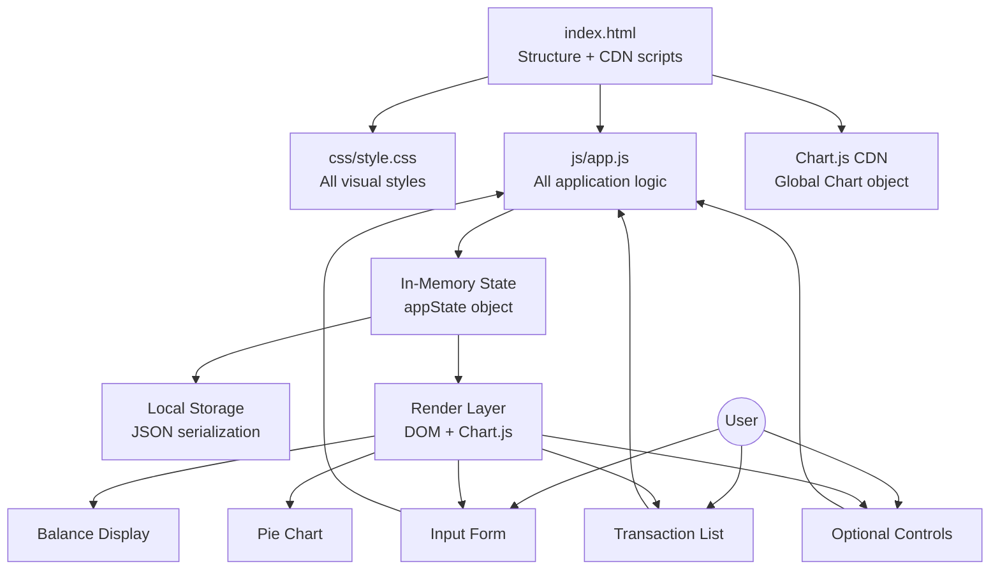

# Design Document

## Expense & Budget Visualizer

---

## Overview

The Expense & Budget Visualizer is a fully client-side, single-page web application built with plain HTML, CSS, and Vanilla JavaScript. It lets users record expense transactions by name, amount, and category; see a running total balance; and understand their spending distribution through a Chart.js pie chart. All data is stored in the browser's Local Storage with no server, no build tools, and no external frameworks beyond Chart.js.

The design intentionally keeps all JavaScript in a single `js/app.js` file, organized via clearly named function groups (modules-in-comment-sections pattern) to satisfy Requirement 11. Every optional feature (custom categories, monthly summary, sort order, spending limits, dark/light theme) is designed as an additive layer — enabling any three of the five does not require restructuring the core.

**Key technical constraints:**
- No JavaScript frameworks or module bundlers
- One CSS file: `css/style.css`
- One JavaScript file: `js/app.js`
- Chart.js loaded via CDN (`<script>` tag in `index.html`)
- Deployed as a static site (GitHub Pages compatible)
- Must work in current stable Chrome, Firefox, Edge, and Safari

---

## Architecture

### File and Folder Structure

```
project-root/
├── index.html          # Single HTML page; links css/style.css and js/app.js
├── css/
│   └── style.css       # All styles — core + optional feature styles, themes
└── js/
    └── app.js          # All application logic — state, rendering, events
```

No other JS or CSS files are permitted (Requirement 11.1–11.3). Chart.js is loaded from the CDN via a `<script>` tag in `index.html` before `js/app.js`.

### High-Level Architecture Diagram



### Execution Flow

1. **Page load**: `init()` runs — reads Local Storage, populates `appState`, calls `renderAll()`.
2. **User action** (add/delete/sort/etc.): event handler mutates `appState`, calls `persistState()` to sync Local Storage, then calls the relevant render function(s).
3. **Render functions** are pure with respect to the DOM — they always re-derive the DOM from `appState` rather than incrementally patching it.

### State Management Approach

A single `appState` object is the single source of truth for the entire application:

```javascript
const appState = {
  transactions: [],     // Transaction[]
  categories: [],       // string[] — default + custom
  sortOrder: null,      // null | 'amount-asc' | 'amount-desc' | 'category-alpha'
  spendingLimit: null,  // null | number
  theme: 'light',       // 'light' | 'dark'
  activeView: 'list',   // 'list' | 'monthly' — optional feature
};
```

All mutations go through dedicated setter/action functions that:
1. Update `appState`
2. Call `persistState()` to write the relevant key(s) to Local Storage
3. Call the affected render function(s)

This avoids stale reads and keeps the render path predictable.

---

## Components and Interfaces

### HTML Component Layout

```
┌─────────────────────────────────────────────────────┐
│  Header: "Expense & Budget Visualizer"   [🌙 Toggle]│  ← optional
├─────────────────────────────────────────────────────┤
│  Balance Display: $0.00                             │
│  [Spending Limit: $___] [Set]                       │  ← optional
├──────────────────────┬──────────────────────────────┤
│  Input Form          │  Pie Chart                   │
│  Item Name: [      ] │  [Chart.js canvas]           │
│  Amount:    [      ] │                              │
│  Category:  [▼     ] │  Legend (per category total) │
│  [Add Transaction]   │                              │
├──────────────────────┴──────────────────────────────┤
│  [Sort: ▼]  [Full List | Monthly Summary]           │  ← optional
├─────────────────────────────────────────────────────┤
│  Transaction List (scrollable)                      │
│  ┌───────────────────────────────────────────────┐  │
│  │ Coffee  $4.50  Food     [Delete]              │  │
│  │ Taxi    $12.00 Transport [Delete]             │  │
│  └───────────────────────────────────────────────┘  │
│  ─ or ─                                             │
│  Monthly Summary View                               │  ← optional
│  ┌ October 2025 ─────────────────────────────────┐  │
│  │ Food: $45.00  Transport: $30.00               │  │
│  └────────────────────────────────────────────────┘ │
└─────────────────────────────────────────────────────┘
```

### JavaScript Function Groups (within `js/app.js`)

The single `app.js` file is organized into clearly delimited sections using comment banners:

```
// ─── CONSTANTS ──────────────────────────────────────────────
// ─── STATE ──────────────────────────────────────────────────
// ─── LOCAL STORAGE ──────────────────────────────────────────
// ─── VALIDATION ─────────────────────────────────────────────
// ─── BUSINESS LOGIC ─────────────────────────────────────────
// ─── RENDER: BALANCE ────────────────────────────────────────
// ─── RENDER: TRANSACTION LIST ───────────────────────────────
// ─── RENDER: PIE CHART ──────────────────────────────────────
// ─── RENDER: FORM ───────────────────────────────────────────
// ─── OPTIONAL: CUSTOM CATEGORIES ────────────────────────────
// ─── OPTIONAL: MONTHLY SUMMARY ──────────────────────────────
// ─── OPTIONAL: SORT ORDER ───────────────────────────────────
// ─── OPTIONAL: SPENDING LIMIT ───────────────────────────────
// ─── OPTIONAL: THEME TOGGLE ─────────────────────────────────
// ─── EVENT HANDLERS ─────────────────────────────────────────
// ─── INIT ────────────────────────────────────────────────────
```

#### Key Function Interfaces

```javascript
// --- Business Logic (pure functions, testable) ---

/** Returns the sum of all transaction amounts, rounded to 2 decimal places. */
function computeBalance(transactions)

/** Groups transactions by category; returns { [category]: totalAmount } */
function aggregateByCategory(transactions)

/** Returns a copy of transactions sorted by the given sort order. */
function sortTransactions(transactions, sortOrder)

/** Groups transactions by calendar month (YYYY-MM); returns array of
 *  { month: string, categories: { [category]: total } } in reverse order. */
function groupByMonth(transactions)

/** Returns true if balance > spendingLimit (and limit is set). */
function isOverLimit(balance, spendingLimit)

/** Formats a number as currency: "$1,234.56" or "-$1,234.56". */
function formatCurrency(amount)

/** Validates a transaction input; returns { valid: boolean, errors: string[] }. */
function validateTransaction(name, amount, category)

/** Validates a custom category name against existing categories. */
function validateCustomCategory(name, existingCategories)

/** Validates a spending limit input. */
function validateSpendingLimit(value)

// --- Local Storage (side-effecting, testable via mock) ---

/** Reads and returns the full persisted state from Local Storage.
 *  Returns null on unavailability; throws on parse error (caller handles). */
function loadFromStorage()

/** Writes the current appState to Local Storage.
 *  Catches write errors and shows an error message. */
function persistState()

// --- Render (DOM-mutating) ---

function renderBalance()
function renderTransactionList()
function renderPieChart()
function renderCategoryDropdown()
function renderMonthlySummary()
function renderAll()
```

### Chart.js Integration

Chart.js v4 is loaded from the CDN. A single `Chart` instance is created on `init()` and stored in a module-level variable `let pieChart = null`. On every state change that affects transactions, `updatePieChart()` is called:

```javascript
function updatePieChart() {
  const data = aggregateByCategory(appState.transactions);
  const labels = Object.keys(data);
  const values = Object.values(data);

  if (labels.length === 0) {
    // Show placeholder, hide canvas
    showChartPlaceholder();
    return;
  }
  hideChartPlaceholder();

  if (!pieChart) {
    pieChart = new Chart(ctx, {
      type: 'pie',
      data: { labels, datasets: [{ data: values }] },
      options: {
        plugins: {
          legend: { display: true },
          tooltip: {
            callbacks: {
              label: (context) => {
                const total = context.dataset.data.reduce((a, b) => a + b, 0);
                const pct = ((context.parsed / total) * 100).toFixed(1);
                return `${context.label}: ${formatCurrency(context.parsed)} (${pct}%)`;
              }
            }
          }
        }
      }
    });
  } else {
    pieChart.data.labels = labels;
    pieChart.data.datasets[0].data = values;
    pieChart.update();   // animates to new values without full re-creation
  }
}
```

This avoids destroying and re-creating the Chart instance on every update, which prevents animation glitches and is the [recommended Chart.js update pattern](https://www.chartjs.org/docs/latest/developers/updates.html).

---

## Data Models

### Transaction

```javascript
/**
 * @typedef {Object} Transaction
 * @property {string} id         - UUID (crypto.randomUUID() or Date.now() fallback)
 * @property {string} name       - Item name (1–100 chars)
 * @property {number} amount     - Positive number, max 999,999,999.99
 * @property {string} category   - Category name
 * @property {string} createdAt  - ISO 8601 date string (for monthly grouping)
 */
```

### AppState (in-memory)

```javascript
/**
 * @typedef {Object} AppState
 * @property {Transaction[]} transactions
 * @property {string[]}      categories    - Default + custom; always includes Food, Transport, Fun
 * @property {string|null}   sortOrder     - null | 'amount-asc' | 'amount-desc' | 'category-alpha'
 * @property {number|null}   spendingLimit - null = no limit
 * @property {'light'|'dark'} theme
 * @property {'list'|'monthly'} activeView
 */
```

### Local Storage Schema

All data is stored under a single key `expense-budget-visualizer` to keep reads/writes atomic:

```javascript
// Key: 'expense-budget-visualizer'
// Value: JSON string of:
{
  "transactions": [ /* Transaction[] */ ],
  "customCategories": [ /* string[] — only user-added; defaults are never persisted */ ],
  "sortOrder": "amount-asc" | "amount-desc" | "category-alpha" | null,
  "spendingLimit": 500.00 | null,
  "theme": "light" | "dark"
}
```

**Design rationale for a single key**: Atomic writes prevent partially-saved state. If the app writes transactions and then the browser crashes before writing categories, the data stays consistent on next reload.

Default categories (`Food`, `Transport`, `Fun`) are defined as constants in `app.js` and are never written to storage. On load, `appState.categories` is always rebuilt as `[...DEFAULT_CATEGORIES, ...customCategories]`.

### Monthly Summary Derived View

The monthly summary is computed on-demand from `appState.transactions` via `groupByMonth()` — it is not stored separately. This avoids synchronization bugs between stored transactions and stored summaries.

```javascript
// groupByMonth output shape:
[
  {
    month: "2025-10",           // YYYY-MM
    label: "October 2025",      // display string
    categories: {
      "Food": 45.00,
      "Transport": 30.00
    },
    total: 75.00
  },
  // ... in reverse chronological order
]
```

---

## Correctness Properties

*A property is a characteristic or behavior that should hold true across all valid executions of a system — essentially, a formal statement about what the system should do. Properties serve as the bridge between human-readable specifications and machine-verifiable correctness guarantees.*

### Property 1: Valid transaction add grows the list

*For any* transaction list and any valid transaction input (non-empty name, positive amount, valid category), adding the transaction should increase the list length by exactly 1 and the new transaction should be present in the updated list.

**Validates: Requirements 1.3**

---

### Property 2: Invalid form submissions are rejected

*For any* form submission where at least one required field is empty or the amount is ≤ 0, the transaction list should remain unchanged after the submission attempt.

**Validates: Requirements 1.4, 1.5**

---

### Property 3: Form clears after successful add

*For any* valid transaction submission, after the transaction is added the input name field should be empty, the amount field should be empty, and the category dropdown should show its placeholder value.

**Validates: Requirements 1.6**

---

### Property 4: Transaction list renders all transactions

*For any* non-empty transaction list, every transaction's name, amount, and category should appear in the rendered HTML of the transaction list, and every rendered entry should include a delete button element.

**Validates: Requirements 2.1, 2.4**

---

### Property 5: Delete removes transaction from state and storage

*For any* transaction list and any transaction within it, after deleting that transaction it should not appear in `appState.transactions` and should not appear in the dataset written to Local Storage.

**Validates: Requirements 2.5, 5.2**

---

### Property 6: Balance equals the sum of transaction amounts

*For any* list of transactions, the value returned by `computeBalance()` should equal the arithmetic sum of all `amount` fields, rounded to 2 decimal places and formatted with a leading currency symbol. For an empty list the result should be `$0.00`. For a negative sum the result should be prefixed with a minus sign (e.g., `-$50.00`).

**Validates: Requirements 3.1, 3.4, 3.5**

---

### Property 7: Chart data matches aggregated category totals

*For any* set of transactions, the labels and data values produced by `aggregateByCategory()` should exactly equal the set of categories present in the transactions with each category's value equal to the sum of transaction amounts for that category, rounded to 2 decimal places.

**Validates: Requirements 4.1, 4.4**

---

### Property 8: Tooltip percentage is correctly computed

*For any* category total and overall total (both positive), the tooltip percentage value should equal `(categoryTotal / overallTotal * 100)` rounded to 1 decimal place, and should sum to 100% across all categories (within floating-point rounding tolerance).

**Validates: Requirements 4.5**

---

### Property 9: Transaction storage round-trip preserves data

*For any* list of transactions serialized to Local Storage and then deserialized via `loadFromStorage()`, the resulting transaction list should be deeply equal to the original list (same id, name, amount, category, and createdAt for every entry).

**Validates: Requirements 5.1, 5.3**

---

### Property 10: Custom category validation rejects duplicates and empty names

*For any* custom category name that is either empty (after trimming) or matches an existing category name (case-insensitive), calling `validateCustomCategory()` should return invalid, and the categories array should remain unchanged after the attempt.

**Validates: Requirements 6.4, 6.5**

---

### Property 11: Custom category add persists to storage

*For any* valid custom category name, after adding it the category should appear in the Category dropdown, and loading from Local Storage should return a custom categories list that includes that name.

**Validates: Requirements 6.2, 6.3**

---

### Property 12: Sort ordering invariant holds for all inputs

*For any* non-empty transaction list and any of the three sort orders, the output of `sortTransactions()` should satisfy the ordering invariant: for amount-asc each element's amount ≤ the next element's amount; for amount-desc each element's amount ≥ the next; for category-alpha each element's category is lexicographically ≤ the next. Ties retain their original relative order (stable sort).

**Validates: Requirements 8.2**

---

### Property 13: Sort preference persists and is restored

*For any* selected sort order written to Local Storage, the value recovered by `loadFromStorage()` should equal the value that was written.

**Validates: Requirements 8.4**

---

### Property 14: Invalid spending limits are rejected

*For any* spending limit input that is non-numeric, zero, negative, or greater than 999,999,999.99, `validateSpendingLimit()` should return invalid and the stored spending limit should remain unchanged.

**Validates: Requirements 9.2**

---

### Property 15: Spending limit comparison determines highlight state

*For any* balance value and spending limit where balance > limit, `isOverLimit()` should return true. For any (balance, limit) pair where balance ≤ limit, it should return false. When no limit is set (`null`), it should always return false regardless of balance.

**Validates: Requirements 9.3, 9.4**

---

### Property 16: Spending limit persists and is restored

*For any* valid spending limit value written to Local Storage, the value recovered by `loadFromStorage()` should equal the value that was written (preserved as a number).

**Validates: Requirements 9.5**

---

### Property 17: Monthly grouping excludes empty months

*For any* transaction set, the output of `groupByMonth()` should contain exactly one entry per distinct calendar month that appears in the transactions' `createdAt` dates, in reverse chronological order, with no entries for months that have no transactions.

**Validates: Requirements 7.2, 7.4**

---

### Property 18: Theme activation applies correct class and persists

*For any* theme value (`'light'` or `'dark'`), activating that theme should add the corresponding CSS class to the root element and `loadFromStorage()` should return that theme value after it has been persisted.

**Validates: Requirements 10.2, 10.3**

---

## Error Handling

### Error Categories and Responses

| Error Condition | Detection Point | User-Facing Response | App Continues? |
|---|---|---|---|
| Local Storage unavailable on read | `init()` | Banner: "Local Storage is unavailable. Your data cannot be saved." | Yes, empty state |
| Local Storage unavailable on write | `persistState()` | Banner: "Failed to save data. Changes may be lost." | Yes |
| Corrupt Local Storage data | `loadFromStorage()` JSON.parse fails | Banner: "Stored data is corrupted and has been cleared." | Yes, empty state |
| Local Storage write fails for spending limit | `saveSpendingLimit()` | Inline error near the limit field | Yes, previous limit retained |
| Form validation failure | Form submit handler | Inline error labels per field | No transaction added |
| Custom category validation failure | Category add handler | Inline error near the category input | No category added |
| Chart.js unavailable (CDN blocked) | `init()` / `renderPieChart()` | Inline message: "Chart could not be loaded." | Yes, chart area hidden |
| Browser does not support Local Storage | Feature detection in `init()` | Full-page banner: "This browser is not supported (Local Storage required)." | Yes, read-only mode |

### Error Display Strategy

- **Inline validation errors**: Appear immediately below the relevant field, cleared on next valid input. Use `aria-live="polite"` regions so screen readers announce them.
- **System banners**: Appear at the top of the page (below the header) as dismissible notices. Use `role="alert"` for screen reader announcement. Auto-dismiss after 8 seconds for non-critical errors; persist for storage unavailability.
- **Empty state messages**: Rendered as part of the normal DOM when the relevant collection is empty (transaction list empty, chart has no data). These are not errors but graceful degradation states.

### Local Storage Error Handling Pattern

```javascript
function loadFromStorage() {
  try {
    const raw = localStorage.getItem(STORAGE_KEY);
    if (!raw) return null;
    return JSON.parse(raw);
  } catch (e) {
    if (e instanceof DOMException) {
      showSystemBanner('Local Storage is unavailable. Your data cannot be saved.', 'error');
      return null;
    }
    // SyntaxError from JSON.parse
    showSystemBanner('Stored data is corrupted and has been cleared.', 'warning');
    localStorage.removeItem(STORAGE_KEY);
    return null;
  }
}

function persistState() {
  try {
    localStorage.setItem(STORAGE_KEY, JSON.stringify(buildStoragePayload()));
  } catch (e) {
    showSystemBanner('Failed to save data. Changes may be lost.', 'error');
  }
}
```

---

## Testing Strategy

### Dual Testing Approach

This project uses two complementary test types for the pure-function business logic layer:

- **Property-based tests**: Verify universal properties across many generated inputs (covering the Correctness Properties section above)
- **Example-based unit tests**: Verify specific concrete scenarios, edge cases, and UI rendering expectations

DOM-dependent behavior (event wiring, chart rendering, theme application) is tested through integration or manual browser testing.

### Property-Based Testing

**Library**: [fast-check](https://fast-check.dev/) — a TypeScript/JavaScript property-based testing library suitable for vanilla JS projects loaded via CDN or npm.

**Configuration**: Minimum 100 runs per property (fast-check default is 100; this is sufficient given the pure-function nature of the tested logic).

**Tag format for each property test**:
```javascript
// Feature: expense-budget-visualizer, Property N: <property text>
```

**Properties to implement as property tests** (mapped from Correctness Properties section):

| Property | Function(s) Under Test | Generator Strategy |
|---|---|---|
| P1: Valid transaction add grows list | `validateTransaction`, array mutation | `fc.record({ name: fc.string({minLength:1, maxLength:100}), amount: fc.float({min:0.01, max:999999999.99}), category: fc.constantFrom(...CATEGORIES) })` |
| P2: Invalid submissions rejected | `validateTransaction` | `fc.oneof(fc.record({name: fc.constant('')}), fc.record({amount: fc.float({max:0}}))` |
| P3: Form clears after add | `validateTransaction` + state mutation | Same as P1 |
| P4: List renders all transactions | `renderTransactionList` (DOM) | `fc.array(transactionArbitrary, {minLength:1})` |
| P5: Delete removes from state+storage | array filter + `persistState` | `fc.array(transactionArbitrary, {minLength:1})` + index |
| P6: Balance sum correctness | `computeBalance` | `fc.array(fc.float({min:-1e9, max:1e9}))` |
| P7: Chart data aggregation | `aggregateByCategory` | `fc.array(transactionArbitrary, {minLength:1})` |
| P8: Tooltip percentage | percentage calculation function | `fc.float({min:0.01}), fc.float({min:0.01})` |
| P9: Storage round-trip | `loadFromStorage` + `persistState` | `fc.array(transactionArbitrary)` |
| P10: Custom category validation | `validateCustomCategory` | `fc.array(fc.string())` + duplicate/empty generators |
| P11: Custom category persists | category array + `persistState` | `fc.string({minLength:1, maxLength:50})` |
| P12: Sort ordering invariant | `sortTransactions` | `fc.array(transactionArbitrary, {minLength:2})` + `fc.constantFrom('amount-asc','amount-desc','category-alpha')` |
| P13: Sort preference persists | `persistState` + `loadFromStorage` | `fc.constantFrom('amount-asc','amount-desc','category-alpha')` |
| P14: Invalid spending limit rejected | `validateSpendingLimit` | `fc.oneof(fc.constant(0), fc.float({max:0}), fc.constant(1e10))` |
| P15: Spending limit comparison | `isOverLimit` | `fc.float(), fc.float()` |
| P16: Spending limit persists | `persistState` + `loadFromStorage` | `fc.float({min:0.01, max:999999999.99})` |
| P17: Monthly grouping excludes empty months | `groupByMonth` | `fc.array(transactionWithDateArbitrary, {minLength:1})` |
| P18: Theme activation | theme setter + `loadFromStorage` | `fc.constantFrom('light', 'dark')` |

### Example-Based Unit Tests

Example tests cover:
- `computeBalance([])` returns `$0.00`
- `computeBalance` with a negative sum formats with leading minus
- `validateTransaction` returns correct field-level error messages
- `loadFromStorage` returns `null` when no data is stored
- `loadFromStorage` returns `null` and shows error when JSON is malformed
- Default categories are always present in `appState.categories` after init
- Empty transaction list shows the "no transactions" message in the DOM
- Pie chart placeholder is shown when `appState.transactions` is empty

### Integration / Manual Tests

The following require browser execution and are verified manually or with an accessibility audit tool:
- App loads correctly in Chrome, Firefox, Edge, Safari (Requirement 12)
- All UI elements visible without overlap in each browser (Requirement 12.2)
- WCAG 2.1 Level AA contrast ratios in light and dark themes (Requirement 10.5) — verify with axe DevTools or browser accessibility inspector
- Chart.js CDN fallback behavior when offline
- Local Storage unavailability error banner (test using DevTools → Application → Storage → disable)

### Test File Location

Since there are no build tools, property and unit tests are run in a Node.js environment using a test runner that supports vanilla JS (e.g., Jest or Vitest with jsdom). The test file lives alongside the project:

```
project-root/
├── index.html
├── css/style.css
├── js/app.js
└── tests/
    └── app.test.js    # All property-based + example-based tests
```

The `tests/` directory is for local development only and is not deployed to GitHub Pages.
